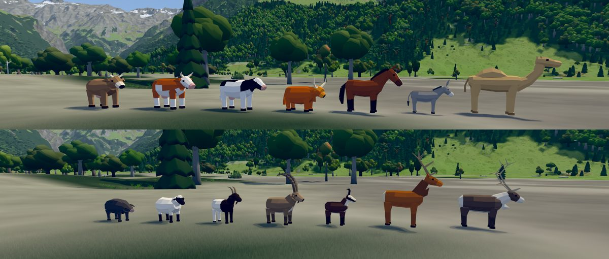
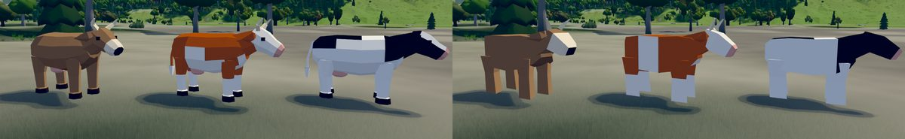
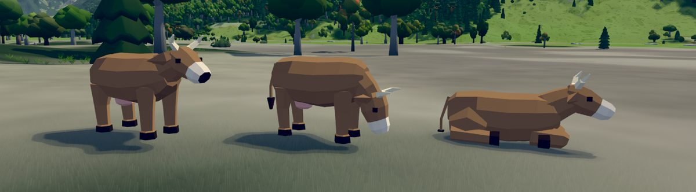
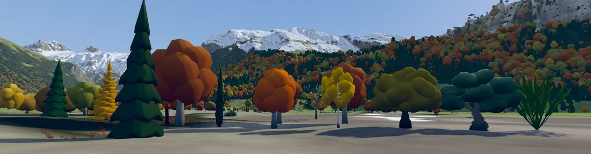
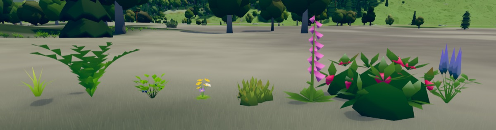

# How TrailView models look

TrailView draws many small models: animals, trees, plants, rocks, benches and other objects. All of
them have one style, "soft low-poly". This page says what the style is and why we keep it. The bytes
of a model file and the triangle budget of each kind are in the
[model contract](src:specs/trailview-models.md).

## The style

A model is low in detail and looks like a model from a game. It is friendly and never odd. A rider
sees it for a moment, at the side of a trail, so its shape must read at once.

- **Round shapes.** An animal's body is a skin through rings of 8 to 12 sides. Each face has one
  flat colour and one normal, so the facets show and the light gives the shape. Trees and plants
  are smooth: see [Trees](#trees) and [Plants](#plants).
- **Clear outlines.** A model reads from the side and from above. Legs, ears, horns and tails stand
  out from the body. A detail that a rider cannot see at 10 m does not get a triangle.
- **Friendly proportions.** An animal has a slightly large head with eyes and a pale muzzle, short
  sturdy legs and a round body. The proportions come from the real species; the style only rounds
  and softens them.
- **Few colours.** A coat has two or three colours in large areas: a back, a belly, a face, patches
  with clear edges. Many small colour changes look like noise at a distance.

## Why we make every model in code

We make all models ourselves, in TypeScript. We do not ship models from asset packs or from
image-to-3-D tools, even with a free licence. A model from another source has another style, and
two sources never agree. Packs and photos are only references.

The animals use one shared kit ([`sculpt.ts`](src:builder/web/src/lib/trailview/models/sculpt.ts)),
which has few parts:

- a **skin** through rings, with a separate reach above and below the middle, a pitch and a
  squareness, for bodies, necks, heads and legs;
- a **leaf**, a flat diamond, for ears, beards and short tails;
- a **chain** of bars for horns, antlers and tails.

Each face of a part turns away from a point inside the part, so no model needs a hand-made winding
order. The animals share one more layer, a four-legged body
([`quadruped.ts`](src:builder/web/src/lib/trailview/models/animals/body/quadruped.ts)) that a
breed fills with its numbers.

## Tiers: one build, two levels of detail

Each model builds its near tier and its far tier from the same code. The far tier uses fewer sides
and leaves out fine details such as eyes and udders. So the outline and the colour areas stay the
same when an animal moves from one tier to the other. For an animal, the near tier ends at 150 m.
Past it, an animal is only a few pixels tall.

## Poses and coats

An animal has two or three poses: it stands, it grazes, or it lies. A herd mixes them, so a group
looks alive. A breed has one to four coats, and most animals of a group wear the first coat.

## Trees

Trees fill the screen, so their crowns have smooth light, not facets. Faceted crowns looked flat
and cheap in a forest. The trees have a builder of their own
([`trees.ts`](src:builder/web/src/lib/trailview/models/trees.ts)); a species file in `trees/`
gives its numbers, colours and features.

- **The species shows in the outline.** A crown is many soft lumps or needle pads on visible limbs,
  in the outline of the species: the flat pads of a pine, the flame of a cypress, the drooping
  sprays of a larch, the rods of a broom.
- **Flowers and fruit are shapes.** Blossom, berries, cones and catkins are small modelled
  clusters, not painted spots.
- **A bare crown is a tree.** In winter every twig grows from a branch and every branch from a
  limb, at each tier.
- **Each tier keeps the outline.** The far tiers keep the same limbs and crown, with fewer parts.

## Plants

Plants stand near the eye in large numbers, so they keep the smooth light of the trees. Most are
thin leaves and blades, which have no body to facet; the fleshy cacti and spurges are smooth too.
Each plant is a file in `plants/` that builds its three shapes in each season with the parts of
[`plant-shape.ts`](src:builder/web/src/lib/trailview/models/plant-shape.ts): blades, kites, round
stems and soft cushions.

- **The species shows in the outline.** The shuttlecock of a fern, the cupped flowers on bowed
  stalks of a meadow flower, the thick pads of a prickly pear.
- **Flowers, berries and seed heads are shapes,** on stems, not painted spots.
- **A bush stands on a soft cushion,** and its leaves light as one round dome.
- **A plant that dies back is not there.** A plant file builds no model for a season in which it
  has died back, and the engine draws nothing for it then.
- **The ground gives the colour.** Most ground plants take much of their colour from the ground
  under them, so a meadow of tufts reads as the meadow. A flowering plant keeps more of its own,
  so its flowers show.

## A new model

A new model or a change to a model is a change of look. The review page
(`builder/web/tests/browser/trailview/models.mjs`) shows each animal, tree species or plant in TrailView's
own light, at each tier, with its triangle and vertex counts against the budget, and the old model
beside it. The owner approves the pictures before the change merges.
