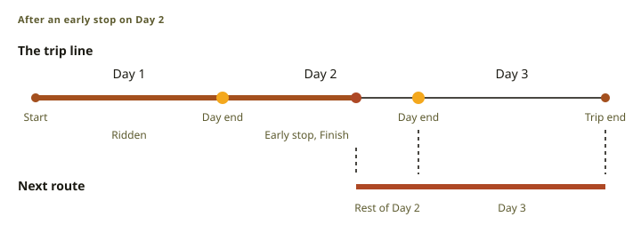
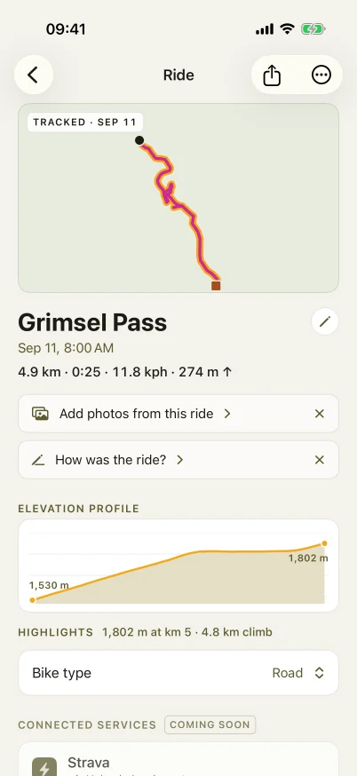

# Trips and rides

A trip is a ride of several days. The rider plans it in the web planner or on the phone, rides it
day by day on the device, and keeps the rides as a journal on the phone. Three rules shape the
design:

- **A trip is one line.** It has day ends on it. Trip progress is a position on that line.
- **The device stays simple.** It receives one ordinary route per day.
- **The phone is the library.** Ride edits live on the phone. The device copy of a ride never
  changes after sync.

The contracts are the trip object (§7.7) and the ride footer (§7.2) in the
[BLE interface spec](src:specs/ble-interface.md), the route format with its bike-type
table in [OBCR](src:specs/obcr-route.md), and the device's trip progress record in the
[ride-archive Metadata](src:specs/ride-archive-metadata.md).

## One line on the phone, day routes on the device

On the phone, a trip is one line with day ends on it. It is not a folder of separate routes. The
line and the day ends come from the trip's plan: the same plan object the web planner uses
([planner plan](src:specs/planner-plan.md)). The rider edits the plan in the phone's planner, and a
save makes the line and the day ends from it again.

The device does not know this line. At upload, the phone cuts the line at the day ends into one
route per day. Each day route has the trip's bike type and a name such as "Day 2 Ulrichen". Then
the phone writes a small trip object that lists the day routes in ride order. The navigator on the
device sees only ordinary routes, so every route feature works on a trip day without extra code.
The phone sends only the day routes that changed, and it sends the trip object last. An
interrupted upload so never leaves a trip that points at nothing.

### Day ends are places

The phone stores a day end as a coordinate with a name, not as a distance. When a file joins the
line, the phone projects each day end onto the new line again, near its old distance. The old
distance keeps a day end on its own leg of an out-and-back line or a loop. A day end that is now
far from the line is removed.

A save from the phone's planner keeps the trip's key, dates, device links, notes and photos. A day
end that stays at its place keeps its day's name, its place name and its transfer label. Day notes
and rides belong to a day number, so they stay with that number when the day count changes.

## Planning a trip

### From files to a trip

An import asks once: keep the file's line, or plan it on roads. When the planner cannot follow
the line, the phone keeps it and says why. One file is saved as a route and its page opens. When
the rider shares several files at once, the phone asks to make one trip from them. It proposes an
order that chains the file ends. The rider can drag the rows into a different order.
Between two rows, the sheet says "joins" or shows the gap. A trip made from files gets one day per
file, with the day ends on the file boundaries, and its page opens. Its plan has each file's
line, kept or planned, with a night at each day end and a transfer leg where the next file starts
more than 200 m away. A trip has at most 14 days, the limit of the plan format: the phone does not
add a 15th file and says so in one line. Add to trip and Group into trip keep each route's line as
a drawn leg.

### Days in the planner

In the web planner, a "Multi-day trip" plan splits its route into riding days. The elevation
profile is the timeline. Each day has a label with its date, distance and riding time, each night
has a marker, and each rest day has a narrow column. While the profile is open, a row above it
holds the start date, the day count and the kinds of places to sleep in.

A value that the planner guessed has a dashed line. A day count or a date that the rider set has a
solid line. The planner guesses the day count from the riding time at the pace of the plan. After
each route or pace change, it guesses the count and the suggested nights again. It never changes a
value that the rider set, so a new plan needs no settings. The day count is the only control for
the length of the days. A bar for the riding time of each day shows the hard days.

"Choose" or "Change" on a night, or its marker in the profile, opens the night in the day list.
"Stay here" on a town moves the night there, and so does a drag of the day end. "Stay here" on a
campsite or a hotel keeps the night. A kept night is a place, with a filled marker. A moved night
is a point on the route, with a dotted marker on the map. The planner keeps both. "Let the planner
choose" makes the night a suggestion again. "This night" sets other kinds of places for this night
only. A night of one kind only (campsites, huts or shelters) ends at a place of that kind. Other
nights end in the town, as "Around Ulrichen", because the planner cannot pick a hotel in the
rider's price range. With a start date, each night shows its sunset and its usual night
temperature.

The plus sign between two days adds a rest day or a train or bus. The next day starts where the
train or bus arrives. When the arrival is on the route ahead, the train or bus skips the route
between. A night that a train or bus leaves from is kept, and it cannot move until the rider
removes the train or bus.

The plan stores which values the rider set ([planner plan](src:specs/planner-plan.md)).

On the phone, "Edit" on the trip page opens the phone's planner, where "End day here" adds a night.
Save offers "Save changes", which writes the plan into the trip, and "Save as copy…", which makes a
new trip.

### Saved versions

The Version menu in the top bar switches between the saved versions. A switch first writes the open
plan back into its version, so no work is lost. "Compare versions" shows both routes on one map,
the days of both versions side by side with their riding time, and both elevation profiles on one
scale. The compare screen has no share button, because the planner keeps plans only in the browser.

### Transfers

A day end is a transfer when the next day starts more than 200 m from it: the rider takes a train,
a bus or a ferry. The phone and the device derive this from the two day routes. The trip object
has no field for it. 200 m is also the distance at which the device's START RIDE asks how to get
to the start, so that prompt covers the way to the next start.

In the plan, a transfer is a leg mode: "Transfer (not ridden)" in the leg menu, or "Train or bus"
between two days of the day list. The planner draws it as a muted dashed straight line and does not
count it in distance, time, climb or the day figures; the profile has a gap there. A trip saved
from the plan has a gap in its line at each transfer, so the day routes and the trip totals do not
contain it.

In the journal, the rider can label a transfer as Train, Bus, Ferry or Car. The label never goes
to the device.

### Dates, bike type and estimates

A trip can have a start date. Dates follow the rides: when the rider rides Day 2 on Wednesday and
not on Tuesday, Day 3 shows Thursday.

The trip has one of four bike types, and each day route carries it. The phone and the device show
the same estimate, from one table for each bike type. The web planner shows the router's time at
the pace of the plan, which can differ.

## Riding a trip on the device

### The next day

The device keeps one progress record per trip. It writes the record when the rider finishes a ride
on a trip day: where the ride stopped on the line, the last finished day, and the date of each
finish. The record never crosses the wire, and a re-upload of the same trip keeps it. A ride that
starts on a trip day also makes that trip the active trip.

The next day is the day after the last finished day, or the day of the last position when that is
later. The route list shows the trip as one row ("Day 2 next · 3 days", then "Done · 3 days").
The start card shows the bike type, Start ride and a row for the active trip's next day, such as
"Day 3 Brig", with "Show route" and its distance. That row opens the day's route detail. After an
early stop, the row first builds the joined route.

### Stopping early

A rider does not always reach the planned day end. When the rider finishes 20 km before the end of
Day 2, Day 3 is next. The device then builds the next day itself: the rest of Day 2, then Day 3. It
uses the same splice code as detours and visits
([`splice.rs`](src:firmware/obc-route/src/splice.rs)), so the navigator receives an ordinary route.

<figure class="fig">

Scroll horizontally to see the full diagram.

<figcaption>The device makes one ordinary route from the early stop to the end of Day 3. A stop within the last 500 m of a day, or a transfer after it, gives the next day as it is.</figcaption>
</figure>

The device does not load one long route with a window on it: every consumer of a route total
would then have to know the window.

When the rider keeps riding past the day end onto Day 3's route and finishes there, the position
moves onto Day 3. Day 3 is next and loads as it is. When a ride on "rest of Day 2 plus Day 3" ends
before it reaches Day 3, it finishes Day 2, and Day 3 stays next. Across a transfer the device
never joins two days: the next day loads as it is.

### Arriving at the end

The arrival view appears only when the rider reaches the end of the loaded route during a
recording. It offers three rows:

- **Finish ride** saves today. It is a hold, as on the Paused page.
- **Ride on: Day N** loads the next day's route while the recording continues. It shows only on a
  trip day with a next day and no transfer between them.
- **Keep riding** closes the view. The route stays loaded, and the view does not come back for it.

The view waits for a riding page with nothing over it, so it never covers a gesture or a menu. It
closes by itself when the rider rides on past the end.

### Day done and trip done

After Finish on a trip day, the device shows a card in place of Home. **DAY N DONE** shows today's
ledger, then TOMORROW with the next day's name, distance, climb and estimate. A second page shows
tomorrow's profile. After an early stop, tomorrow is the rest of Day 2 and Day 3, as the start
card loads it. After the last day, **TRIP DONE** shows today's ledger, the trip name, the day count
and the totals of the trip's rides.

The opt-in data field **Trip to go** (tile caption TRIP KM) shows the rest of the loaded day plus
the routes of the later days. A transfer is not ridden, so it does not count. The rider adds the
field in the data-field editor.

Each ride records its trip key, its day, the trip name and the bike type in its footer. So the
device and the phone group the rides of a trip without dates, and the device's ride list shows
them in a trip folder.

## The journal on the phone

### The phone is the library

After a sync, the phone holds the rides. The rider edits, notes and shares them there. The device
copy never changes: the phone keeps each synced ride as it came, and every edit is a view on top
of it. "Revert to original" removes the views and gives back the synced ride.

<figure class="fig">

<figcaption>The ride detail after a sync, with the photo offer and the note prompt.</figcaption>
</figure>

### Ride detail

The ride detail shows the map, the title, the date and one stats line. The elevation profile comes
from the ride's own points. The highlights name the highest point, the longest climb, the fastest
descent and, on a trip, the biggest day. Quiet rows under the stats line offer the next steps. A
row goes away when the rider uses or dismisses it, and it never comes back for that ride.

### Photos by time

The phone offers the photos the rider took during the ride, and the rider picks which to add. A
photo's place on the ride is the ride position at the time the photo was taken. The geotag does not
move the photo, so a photo on an out-and-back stays on the leg of its time. A geotag far from that
place only marks the photo "Location off the track". The phone stores a reference and a thumbnail,
and it never writes to the photo library.

### Day notes

The prompt "How was Day 2?" opens a writer with the date, the places and the distance of the day.
The note saves while the rider types. The rides of one trip day share one note, so a merge never
moves it.

### The trip review

When a trip has rides, its page becomes the journal. The map shows the ridden part, the rest of the
line dashed, each transfer with its symbol, and the photo pins. The totals count the rides, not the
plan. Each ridden day shows its note and photos and opens its ride. The days still to ride stay as
rows.

### Library, sharing and editing

The rides list has a year menu and bike-type filters, a totals card, and a map with every ride on
it. The rider can share a ride as a GPX file or as an image, or save it as a route. A saved route
keeps the ride's line and bike type, and its page opens.

The rider can trim a ride or merge it with the next ride. When the next ride starts
soon after and near the end of a ride, on the same trip day, the ride detail offers to merge them.
Photos stay with their time, and the day note stays with its day.
