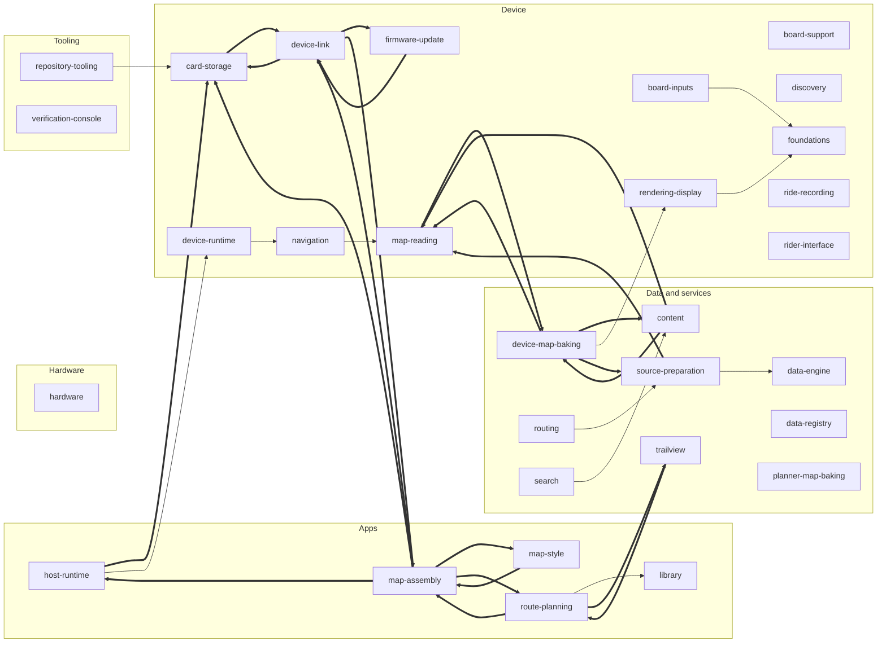

# Systems at a glance

<!-- cairn map: generated by `obc cairn map`; edits between this comment and the end comment are lost -->

## Dependencies

The figure leaves out the shells, and each arrow that a longer path implies. A thick arrow is part of a cycle or is not in `depends_on`. A dashed arrow is in `depends_on`, but not in the code. The table lists every direct dependency in production code.

## Systems

### Apps

| System | Purpose | Status | Uses (production code) | Used by (production code) |
| --- | --- | --- | --- | --- |
| [host-runtime](host-runtime.md) | Runs the device core on a computer or phone instead of the board. | draft | card-storage, device-runtime, foundations, map-reading, navigation, rendering-display | map-assembly, simulators |
| [library](library.md) | Keeps the rider's routes, rides and settings in the browser, each route and ride with a summary, and saves and loads them as one backup file. | draft |  | route-planning, web-planner |
| [map-assembly](map-assembly.md) | Assembles a device map from published cells. | draft | card-storage, device-link, device-map-baking, device-map-builder, foundations, host-runtime, map-reading, map-style, navigation, rendering-display, route-planning | device-link, device-map-builder, map-style, obc-data, route-planning, web-planner |
| [map-style](map-style.md) | Defines how map features look on the device. | draft | device-map-builder, map-assembly | device-map-builder, map-assembly, web-planner |
| [route-planning](route-planning.md) | Lets a rider plan a route on a map, in the browser or on the phone. | draft | device-map-builder, library, map-assembly, trailview | device-map-builder, map-assembly, obc-data, trailview, trailview-page, web-planner |

### Data and services

| System | Purpose | Status | Uses (production code) | Used by (production code) |
| --- | --- | --- | --- | --- |
| [content](content.md) | Collects facts about places (names, articles, photos) for the device and the planner. | draft | device-map-baking, foundations, map-reading, rendering-display | device-map-baking, search |
| [data-engine](data-engine.md) | Runs any product's steps: it fetches, stores, versions and publishes, with no knowledge of maps. | draft |  | device-map-baking, obc-data, routing, search, simulators, source-preparation, trailview |
| [data-registry](data-registry.md) | Declares the external sources, regions, targets and options that `obc data` reads. | approved |  |  |
| [device-map-baking](device-map-baking.md) | Turns prepared sources into the device's map cells. | draft | content, data-engine, foundations, map-reading, rendering-display, source-preparation | content, map-assembly, map-reading, obc-data |
| [planner-map-baking](planner-map-baking.md) | Turns prepared sources into the planner's map releases. | draft |  |  |
| [routing](routing.md) | Finds a bike route between points. | draft | data-engine, source-preparation | obc-data |
| [search](search.md) | Finds places by name. | draft | content, data-engine, device-map-builder | obc-data |
| [source-preparation](source-preparation.md) | Turns raw external datasets into the prepared sources that products build from. | draft | data-engine, foundations, map-reading | device-map-baking, obc-data, routing |
| [trailview](trailview.md) | Renders a region as an explorable 3-D landscape in the browser. | draft | data-engine, route-planning | device-map-builder, obc-data, route-planning, trailview-page, web-planner |

### Device

| System | Purpose | Status | Uses (production code) | Used by (production code) |
| --- | --- | --- | --- | --- |
| [board-inputs](board-inputs.md) | Turns raw sensor bytes and button edges into the values the core reads. | draft | foundations | device-firmware, simulators |
| [board-support](board-support.md) | Drives the nRF54L hardware: radio, USB, microSD, display panel, sensors, buzzer. | draft |  |  |
| [card-storage](card-storage.md) | Keeps the device's objects on the SD card. | draft | device-link, foundations | device-firmware, device-link, host-runtime, map-assembly, repository-tooling, simulators |
| [device-link](device-link.md) | Moves objects between the device and a phone or computer. | draft | card-storage, device-map-builder, firmware-update, foundations, map-assembly, navigation | card-storage, device-firmware, device-map-builder, firmware-update, map-assembly, simulators, web-planner |
| [device-runtime](device-runtime.md) | Drives each frame of the device core. | draft | foundations, map-reading, navigation, rendering-display | device-firmware, host-runtime, repository-tooling, simulators |
| [discovery](discovery.md) | Tells the rider what is around them: places, summits, landmarks. | draft |  |  |
| [firmware-update](firmware-update.md) | Installs a verified firmware image on the device, with rollback. | draft | device-link, foundations | device-firmware, device-link, device-map-builder, simulators, web-planner |
| [foundations](foundations.md) | Holds the shared building blocks that have no product policy: the byte layouts of the file formats, the byte-reading interface, CRC-32, the host interfaces and the map-scene interface. | approved |  | board-inputs, card-storage, content, device-firmware, device-link, device-map-baking, device-runtime, firmware-update, host-runtime, map-assembly, map-reading, navigation, obc-data, rendering-display, repository-tooling, simulators, source-preparation |
| [map-reading](map-reading.md) | Reads the device's map content from the card: OBCM maps, OBCT terrain. | draft | device-map-baking, foundations | content, device-firmware, device-map-baking, device-runtime, host-runtime, map-assembly, navigation, repository-tooling, simulators, source-preparation |
| [navigation](navigation.md) | Guides the rider along a route. | draft | foundations, map-reading | device-firmware, device-link, device-runtime, host-runtime, map-assembly, repository-tooling, simulators |
| [rendering-display](rendering-display.md) | Draws the map and the screens, and updates the display panel. | approved | foundations | content, device-firmware, device-map-baking, device-runtime, host-runtime, map-assembly, simulators |
| [ride-recording](ride-recording.md) | Records the ride: its track, its measurements, its archive on the card. | draft |  |  |
| [rider-interface](rider-interface.md) | Connects the rider to the device: screens, gestures, sound. | draft |  |  |

### Hardware

| System | Purpose | Status | Uses (production code) | Used by (production code) |
| --- | --- | --- | --- | --- |
| [hardware](hardware.md) | Holds the board's schematics, layouts and component models, and makes its parts list with prices. | approved |  |  |

### Tooling

| System | Purpose | Status | Uses (production code) | Used by (production code) |
| --- | --- | --- | --- | --- |
| [repository-tooling](repository-tooling.md) | Keeps the development workflow running: the `obc` command, test selection, CI gates, fixtures. | draft | card-storage, device-runtime, foundations, map-reading, navigation | simulators |
| [verification-console](verification-console.md) | Tracks system requirements against their release evidence. | draft |  |  |

### Shells

| System | Purpose | Status | Uses (production code) | Used by (production code) |
| --- | --- | --- | --- | --- |
| [companion-ios](companion-ios.md) | Runs the iPhone app that plans routes, sends them to the device and gets rides back. | approved |  |  |
| [device-firmware](device-firmware.md) | Builds the nRF54L board image from the device systems. | approved | board-inputs, card-storage, device-link, device-runtime, firmware-update, foundations, map-reading, navigation, rendering-display |  |
| [device-map-builder](device-map-builder.md) | Runs the map builder, where a rider builds a device map and manages the device, in the browser. | approved | device-link, firmware-update, map-assembly, map-style, route-planning, trailview, website | device-link, map-assembly, map-style, obc-data, route-planning, search, web-planner |
| [obc-data](obc-data.md) | Runs the `obc data` command and its operator page. | approved | data-engine, device-map-baking, device-map-builder, foundations, map-assembly, route-planning, routing, search, source-preparation, trailview |  |
| [planner-tile-server](planner-tile-server.md) | Serves the map tiles of a planner release from the storage bucket or from a local folder. | approved |  |  |
| [simulators](simulators.md) | Runs the device core on a computer, a phone or a web page, and sends test input to a real board. | approved | board-inputs, card-storage, data-engine, device-link, device-runtime, firmware-update, foundations, host-runtime, map-reading, navigation, rendering-display, repository-tooling |  |
| [trailview-page](trailview-page.md) | Opens TrailView, the 3-D view of a region, as its own page in the browser. | approved | route-planning, trailview |  |
| [web-planner](web-planner.md) | Opens the app at /plan/: the top bar, the pages, and the route planner as one page. | approved | device-link, device-map-builder, firmware-update, library, map-assembly, map-style, route-planning, trailview |  |
| [website](website.md) | Publishes the project site, the guide and the blog. | approved |  | device-map-builder |

## Tangles

- A cycle between card-storage, device-link, device-map-builder, firmware-update, host-runtime, map-assembly, map-style, route-planning, trailview: card-storage -> device-link, device-link -> card-storage, device-link -> device-map-builder, device-link -> firmware-update, device-link -> map-assembly, device-map-builder -> device-link, device-map-builder -> firmware-update, device-map-builder -> map-assembly, device-map-builder -> map-style, device-map-builder -> route-planning, device-map-builder -> trailview, firmware-update -> device-link, host-runtime -> card-storage, map-assembly -> card-storage, map-assembly -> device-link, map-assembly -> device-map-builder, map-assembly -> host-runtime, map-assembly -> map-style, map-assembly -> route-planning, map-style -> device-map-builder, map-style -> map-assembly, route-planning -> device-map-builder, route-planning -> map-assembly, route-planning -> trailview, trailview -> route-planning
- A cycle between content, device-map-baking, map-reading, source-preparation: content -> device-map-baking, content -> map-reading, device-map-baking -> content, device-map-baking -> map-reading, device-map-baking -> source-preparation, map-reading -> device-map-baking, source-preparation -> map-reading
- route-planning -> planner-map-baking (test) is not in the doc of route-planning
- search -> device-map-builder is not in the doc of search
- trailview -> device-map-builder (test) is not in the doc of trailview

<!-- cairn map: end -->
