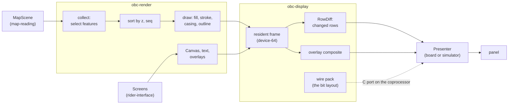

# Rendering & display

## What it does

This system draws one 240 × 320 frame and puts it on the panel. It has two crates.

[`obc-render`](../../firmware/obc-render/src/lib.rs) draws. It reads a map through the `MapScene` interface of [`obc-map-scene`](../../firmware/obc-map-scene/src/lib.rs) and writes pixels to any `embedded-graphics` `DrawTarget`. It also gives the screens their drawing words: `Surface`, `Canvas`, the fonts and the text functions. The device, the simulators, the map bakers' previews and the benchmark run this same code, so a frame on a computer is the frame on the panel.

[`obc-display`](../../firmware/obc-display/src/lib.rs) stores and presents. It holds the frame's draw targets, the frame and presenter contracts, and the code for the shipping panel, the Sharp LS021B7DD02. That code finds the changed rows and defines the bits on the panel's source bus.

The system does not own the screens, the map reader, or the transport to the panel. The rider interface decides what to draw. Map reading supplies the scene. Board support owns [`Ls021Flpr`](../../firmware/obc-fw-nrf54l/src/ls021_flpr.rs) and the scan program on the coprocessor. The guide pages [rendering pipeline](../content/software/rendering.md) and [display protocol](../content/hardware/display-protocol.md) explain the product view.

## A picture

## One frame, step by step

A rider pans the map in a dense town. No hold gesture is active at first.

1. The board's ride loop borrows the resident frame `&mut` and wraps it in `FbDevice64`. The app makes a `Viewport` from the camera and calls `RenderScratch::render_timed` with the map's scene.
2. `render_timed` clears the target. It asks the scene for the level of detail that fits the viewport's metres per pixel.
3. The **direct walk** starts. The scene decodes each candidate in the view. The renderer rejects a malformed feature, culls an invisible one, projects the rest to 16-bit screen points, and appends them to the frame buffers.
4. The town holds more points than `MAX_FRAME_POINTS`, so the direct walk stops and its buffers clear. A late chunk could hold a high-priority feature, and low-priority features already took its room.
5. The **fallback** runs. Pass A walks the scene again and keeps one `Stub` per candidate in a max-heap, in the same slots that later hold the spans. A full heap replaces its worst stub with a better one. Select sorts the stubs by priority and admits each one that fits the point and ring budgets. Pass B returns to the scene and decodes only the winners into the frame buffers.
6. The renderer sorts the spans into paint order: a style's z first, then `seq`. At the finest level of detail, the casings go in at the first cased road, under every road fill. Polygons with the same z get their fills first, then their outlines.
7. The app adds the route, the breadcrumb and the rider marker through the methods of `RenderScratch`. It draws the screen's chrome through `Canvas`. `FbDevice64` stores each pixel as one byte, `0b00RRGGBB`.
8. The board calls `Presenter::present`, and the frame stays borrowed shared. `RowDiff` hashes all 320 rows, updates its store, and joins the changed rows into spans. The coprocessor reads those rows directly from the frame, packs them for the bus, and writes them to the panel. It moves past unchanged rows without a write and stops after the last changed row.
9. If the push stalls, `present` returns an error. The store already holds the new frame, so a plain retry would push nothing. The board calls `reset_diff`, and the next present pushes every row.

Now the rider holds a button. The hold feedback, the bulge, lives on the input plane and is not in the frame. `composite_into_resident` saves the window's clean bytes, writes the composite into the frame, pushes those rows, and restores the bytes, also after a fault. A map redraw during the hold pushes every changed row except the bulge's rows, so the bulge does not flash off. The row store still records those rows as the new frame. When the bulge ends, the presenter pushes its rows from the frame with nothing composited, so the clear needs no map render.

## Its parts

| Part | Purpose |
| --- | --- |
| `obc-render` [`lib.rs`](../../firmware/obc-render/src/lib.rs) | The render entry points, the buffer capacities, the shared scratch, the width ramp and the draw passes. |
| [`collect.rs`](../../firmware/obc-render/src/collect.rs) | Selects the frame's features: the direct walk, then the stub fallback. |
| [`viewport.rs`](../../firmware/obc-render/src/viewport.rs) | Projects microdegrees to screen pixels and tests whether geometry can be visible. |
| [`stroke.rs`](../../firmware/obc-render/src/stroke.rs), [`fill.rs`](../../firmware/obc-render/src/fill.rs), [`sort.rs`](../../firmware/obc-render/src/sort.rs) | Rasterize lines and polygons. |
| [`overlay.rs`](../../firmware/obc-render/src/overlay.rs) | Draws the rider marker, the route with its chevrons, and the breadcrumb. |
| [`canvas.rs`](../../firmware/obc-render/src/canvas.rs), [`surface.rs`](../../firmware/obc-render/src/surface.rs) | The drawing vocabulary of the screens. |
| [`text.rs`](../../firmware/obc-render/src/text.rs), [`font_data.rs`](../../firmware/obc-render/src/font_data.rs), [`text_tap.rs`](../../firmware/obc-render/src/text_tap.rs) | The font tiers, their bitmaps, and a host-only record of drawn text for the copy-fit test. |
| `obc-display` [`framebuffer.rs`](../../firmware/obc-display/src/framebuffer.rs) | The draw targets `FbDevice64` and `Framebuffer565`, with the colour conversions. |
| [`display_contracts/`](../../firmware/obc-display/src/display_contracts/mod.rs) | `NativeFrame`, `Presenter`, `OverlayPresenter` and the conformance suite. |
| [`ls021/`](../../firmware/obc-display/src/ls021/mod.rs) | The panel's geometry, `RowDiff`, the wire pack and the overlay engine. |
| [`panel.rs`](../../firmware/obc-display/src/panel.rs) | `Band`, a frame-absolute view of a window, and the composite that fills it from the frame. |

## Rules that must hold

| Rule | Check |
| --- | --- |
| The renderer drops a feature whole, lowest priority first, across all chunks. | `priority_one_survives_saturation_across_chunks` in [`priority.rs`](../../firmware/obc-render/tests/cases/priority.rs), `frame_points_saturate_before_spans_and_priority_still_wins` in [`fill_edges.rs`](../../firmware/obc-render/tests/cases/fill_edges.rs), `over_capacity_feature_is_dropped_whole_with_typed_stat` in [`errors.rs`](../../firmware/obc-render/tests/cases/errors.rs) |
| A scene is outside the trust boundary. Bad priorities, rings or coordinates never reach the painter or take a later winner's room. | [`static_scene.rs`](../../firmware/obc-render/tests/cases/static_scene.rs); `a_projection_outside_i16_is_rejected_instead_of_wrapping` in [`collect.rs`](../../firmware/obc-render/src/collect.rs) |
| The renderer needs no OBCM bytes and no reader. | `renders_static_scene_without_reader_or_map_bytes`; `obc-reader` is only a dev-dependency |
| Each specialized fill gives the pixels of `fill_polygon`. | `packed_edge_scan_is_pixel_identical_on_pseudo_random_polygons` in [`fill.rs`](../../firmware/obc-render/src/fill.rs), `convex_quad_fill_matches_even_odd_on_pseudo_random_quads` in [`stroke.rs`](../../firmware/obc-render/src/stroke.rs) |
| A row with too many crossings stays empty. It never fills with the wrong parity. | `fill_polygon_skips_rows_that_overflow_the_crossing_buffer` in [`fill.rs`](../../firmware/obc-render/src/fill.rs) |
| Dashes stay at one place on the map while the camera moves. | `a_pan_does_not_slide_the_pattern_along_the_line` in [`stroke.rs`](../../firmware/obc-render/src/stroke.rs) |
| A frame's pixels and read counts change only on purpose. | `obc shot --check` against `firmware/ui-snapshots.sha256`; `obc-bench --check` against [`golden.txt`](../../sim/bench/golden.txt) |
| The frame buffers keep their size and fit the board. | The `const` asserts in [`lib.rs`](../../firmware/obc-render/src/lib.rs) and [`collect.rs`](../../firmware/obc-render/src/collect.rs); `arena_render` in [`resource_baseline.json`](../../firmware/tools/resource_baseline.json), through `resource_guard.py` |
| Neither crate depends on the app, the board or host tools. `obc-render` also stays off the platform crates. | `firmware/tools/check_dependencies.py`, [`dependency_rules.json`](../../firmware/tools/dependency_rules.json) |
| Rendering cannot write a frame that the coprocessor scans. | The compiler. `present` holds a shared borrow of the frame, and rendering needs a mutable one. |
| The frame is byte-identical after an overlay, also after a fault. | `a_push_fault_still_restores_the_frame` in [`ls021/mod.rs`](../../firmware/obc-display/src/ls021/mod.rs); [`conformance.rs`](../../firmware/obc-display/src/display_contracts/conformance.rs) |
| The row store tracks the clean frame, also for excluded rows. | `diff_clipped_updates_the_store_for_excluded_rows` in [`rowdiff.rs`](../../firmware/obc-display/src/ls021/rowdiff.rs) |
| A change in one byte lane of a row changes its hash. | `byte_lane_confined_changes_never_collide` in [`rowdiff.rs`](../../firmware/obc-display/src/ls021/rowdiff.rs) |
| The stored byte matches the quantization of the previews. | `device64_matches_reader_quantization_exhaustively` in [`framebuffer.rs`](../../firmware/obc-display/src/framebuffer.rs) |
| The Rust wire pack and its C port use the same pin map. | `flpr_blob_carries_the_same_pin_map` in [`wire.rs`](../../firmware/obc-display/src/ls021/wire.rs); a change to `flpr_scan.c` selects it through a trigger in [`suites.toml`](../../tools/testing/suites.toml) |
| The frame geometry, the wire row and the scan program agree. | The `const` asserts in [`ls021/mod.rs`](../../firmware/obc-display/src/ls021/mod.rs) and [`ls021_flpr.rs`](../../firmware/obc-fw-nrf54l/src/ls021_flpr.rs) |

## Decisions

- **One renderer for every host.** The code is generic over `DrawTarget` and a colour function, so only the target differs. We rejected a separate preview renderer, because its output would drift from the panel.
- **The renderer sees a scene, not a map file.** `MapScene` exposes opaque tokens and no offsets or cache slots. We rejected a direct edge to the OBCM reader, because a format change would then reach the rasterizer.
- **Fixed buffers, cleared each frame.** A dense city costs no more memory than open country. We rejected a heap, because a dense view could then run the device out of memory.
- **Direct walk first, stubs on overflow.** Most frames fit, and one walk is enough for them. We rejected two passes on every frame, because each walk costs decode work and can read the card. We rejected the direct walk alone, because it drops by arrival order, not by priority.
- **Stubs share the span slots.** The heap uses the buffer that later holds the spans, so selection costs no extra frame memory. We rejected a second candidate buffer. For the same reason, `seq` has three jobs, one at a time. During pass A it holds a stub's arrival. After select it holds the paint order. During the direct walk it holds the priority, until the walk ends and the paint order replaces it. A separate field would grow every slot.
- **Three polygon fills.** `fill_polygon` takes any points and serves the overlays. `fill_polygon_edges` keeps active edges for the map. `fill_convex_quad` serves thick strokes with no scratch. The two fast fills use the same crossing expression as `fill_polygon`. We rejected a precomputed slope, because it moves spans by a pixel near integer boundaries.
- **Immediate-mode screens, with a row hash at the end.** Every redraw draws the whole frame, and the presenter finds what changed. We rejected dirty tracking on writes, because an immediate-mode screen writes everything.
- **One resident frame, read directly by the coprocessor.** We rejected a staging copy, because a second frame doubles the frame's RAM and the scan can read the first one.
- **The overlay goes through the frame and comes back out.** The coprocessor reads only the frame, so the composite must be there during the scan. We rejected rendering the overlay into the map, because a clear would then need a map render.
- **Region repaint rejects whole primitives.** `Canvas` skips a primitive that misses the clip, and the clipped framebuffer discards the rest. We rejected a pixel clip alone, because the rasterizer would still run for a primitive that lands outside.
- **Frame and presenter contracts apart from the panel.** The traits name no rows and no widths, and the LS021 code lives beside them. The contracts carry a conformance suite that the desktop presenter and a host double run. The board's own presenter runs on hardware only.

## Words it introduces

| Word | Meaning |
| --- | --- |
| OBCM | The device's map format, in [`obcm-map.md`](../../specs/obcm-map.md). |
| Chunk | The part of a map that the reader streams as one unit. |
| Candidate | A feature in the view that the scene offers to the renderer. |
| Ring | One closed list of a polygon's points: the exterior first, then the holes. A line uses one ring. |
| Span | One feature in the frame: its style, z, and where its points and rings start. In `RowDiff`, a span is a run of changed rows. |
| Stub | The fixed-size record of a candidate during the fallback. It holds no geometry. |
| Pass A, select, pass B | The three steps of the fallback: record stubs, admit against the budgets, decode the winners. |
| Retention priority | A style's level from 1 to 4. It decides what survives. Paint order, `(z, seq)`, decides what covers what. |
| Casing | The wider, darker base under a road. |
| Device-64 | The panel's gamut of 64 colours, stored as one byte per pixel, `0b00RRGGBB`. |
| Resident frame | The one frame in RAM. Presenters read it, and it holds the clean image when a presenter returns. |
| Row store | The row hashes that `RowDiff` keeps from the last present. |
| Damage | What a present must push. Each presenter has its own type: for the LS021, `RowDamage`. |
| Bulge | The hold-gesture overlay at the screen edge. |
| Input plane | The task that recognizes gestures while the map task renders. The [architecture guide](../content/software/architecture.md) explains the two planes. |
| FLPR | The nRF54L coprocessor that runs the panel scan. |
| Glass | The panel itself, as opposed to the frame in RAM. |
